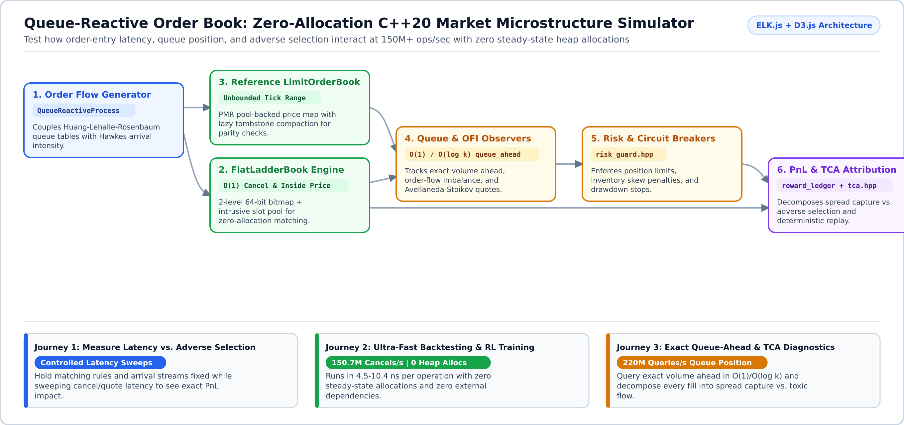
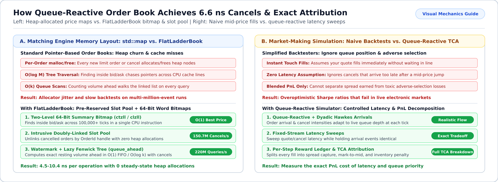

# Queue-Reactive Order Book

**Simulate limit order books, queue priority, and market-making latency at 150M+ operations per second in C++20 with zero steady-state heap allocations.**

`queue-reactive-book` is a self-contained C++20 price-time priority (*FIFO*[^fifo]) matching engine and market-making simulator. It builds with a standard C++20 compiler and `make`—no external package managers or third-party dependencies required.



---

## Why Use This Simulator? (What Problem Does It Solve?)

When you design or backtest a market-making or execution strategy, simplified backtesters that assume "you always fill immediately at the touch" hide the real tradeoff in electronic markets, while standard pointer-based order books (`std::map` + per-order heap nodes) spend most of their time in `malloc`/`free` and cache misses:

- **Cancel too slowly**, and your resting quote gets picked off by faster traders when the price moves against you (*adverse selection*[^adverse-selection]).
- **Cancel too aggressively**, and you lose your place in line (*queue priority*[^queue-ahead]) when the price stays stable.

`queue-reactive-book` lets you hold the matching rules and order-arrival stream fixed while sweeping your order-entry latency, quote width, and inventory penalties—so you can measure exactly how latency changes your profit and loss (PnL), fill rates, and adverse selection.



---

## Start in 2 Minutes (Zero External Dependencies)

All you need is `g++` or `clang++` (with C++20 support) and `make`. Test and benchmark shims are bundled right in `include/test_shim/`.

```bash
# 1. Build and run a 10,000-event queue-reactive simulation with zero-allocation verification
make
./build/sim

# 2. Run the full unit and parity test suite
make test

# 3. Run the high-throughput LTO microbenchmarks
make release-lto && ./build/sim_bench
```

---

## Adapt to Your Use Case (Customer Journeys)

<details open>
<summary><b>1. Quantitative Researchers -- Studying Latency vs. Adverse Selection</b></summary>

- **Who this is for**: Researchers and students studying market microstructure, optimal quoting, or the value of speed in limit order books.
- **Problem solved**: Couples realistic order-arrival intensities (*Queue-Reactive + Hawkes processes*[^queue-reactive]) with exact price-time matching and per-step PnL attribution (`reward_ledger.hpp` and `tca.hpp`), decomposing every trade into spread capture vs. post-trade price movement.
</details>

<details>
<summary><b>2. Reinforcement Learning & High-Speed Strategy Backtesting</b></summary>

- **Who this is for**: ML engineers training RL quoting agents or running millions of Monte Carlo episodes where Python or heap-heavy simulators become the bottleneck.
- **Problem solved**: `FlatLadderBook` pre-reserves an intrusive slot pool and uses a 2-level 64-bit bitmap (`ctzll`/`clzll`) to find best bid/ask and cancel resting orders in **O(1) time (6.6 ns/op)** with **0 heap allocations** on the hot path.
</details>

<details>
<summary><b>3. Execution Algorithm & Queue-Position Modeling</b></summary>

- **Who this is for**: Execution quants comparing TWAP, passive-pegged, and immediate-sweep schedules (`execution_baselines.hpp`).
- **Problem solved**: `FlatLadderBook::queue_ahead(OrderId)` computes the exact volume sitting ahead of your order in **O(1) time (4.5 ns/query)** on pure-FIFO levels and **O(log k)** via a lazy Fenwick tree when interior orders cancel.
</details>

---

## Measured Throughput & Latency

Measured with `./build/sim_bench` on a dual AMD EPYC 7453 ( Linux x86_64, GCC 16):

| Operation (`N = 4096` resting orders) | Default (`-O2`) | Release LTO (`-O3 -flto=auto -march=native`) | Heap Allocs / Op |
| :--- | :--- | :--- | :--- |
| **Cancel Resting Order (`CancelCycle`)** | 104.4 M ops/s (9.6 ns) | **150.7 M ops/s (6.6 ns)** | **0** |
| **Crossing Match (`CrossingMatch`)** | 33.9 M ops/s (29.5 ns) | **96.3 M ops/s (10.4 ns)** | **0** (with `add_into`) |
| **Passive Add (`AddNoCross_AllocProbe`)** | 19.5 M ops/s (51.4 ns) | **37.3 M ops/s (26.8 ns)** | **0 (`0.0 B`)** |
| **100k-Tick Deep Book Refresh** | 45.9 M ops/s (21.8 ns) | **80.6 M ops/s (12.4 ns)** | **0** |
| **Exact Queue-Ahead Query (`QueueAhead/1024`)** | 185.0 M queries/s (5.4 ns) | **220.0 M queries/s (4.5 ns)** | **0** |

---

## Architecture & Module Reference

<details>
<summary><b>View the two matching engines, 4 module layers, sanitizer builds, and academic references</b></summary>

### Two Matching Engines with Verified Parity
1. **`FlatLadderBook` (`include/sim/flat_ladder_book.hpp`)**: Maps a bounded `[min_price, max_price]` tick range onto a flat `std::pmr` array + 64-bit word summary bitmap. Unlinks cancelled orders in `O(1)` time without tombstones.
2. **`LimitOrderBook` (`include/sim/lob.hpp`)**: General-purpose reference engine for unbounded tick ranges using `std::pmr::map` and lazy tombstone compaction.

Both engines support 5 order types (`Limit`, `Market`, `PostOnly`, `IOC`, `FOK`) and 4 self-trade prevention modes (`None`, `CancelPassive`, `CancelAggressive`, `DecrementAndCancel`).

### Four Header Layers (`include/sim/`)
- **Core Matching & Arrivals**: `types.hpp`, `flat_ladder_book.hpp`, `lob.hpp`, `queue_reactive.hpp`.
- **Observation & Quoting Controls**: `queue_state_observer.hpp`, `ofi_sparsity_features.hpp`, `quote_adapters.hpp` (Avellaneda-Stoikov), `risk_guard.hpp`.
- **Evaluation & Transaction-Cost Analysis (TCA)**: `reward_ledger.hpp`, `execution_baselines.hpp`, `tca.hpp`, `tca_diagnostics.hpp`, `impact_diagnostics.hpp`, `survival_labels.hpp`, `exploitability_probe.hpp`.
- **Replay & Schema Contracts**: `replay_checkpoint.hpp`, `export_schema.hpp`, `alloc_probe.hpp`, `bitwise_veb_codings.hpp`. (Experimental harnesses live in [`experimental/`](experimental/README.md)).

### Sanitizer & CMake Builds
```bash
make asan         # AddressSanitizer + UndefinedBehaviorSanitizer
make ubsan        # UndefinedBehaviorSanitizer
make tsan         # ThreadSanitizer
```

### Primary Literature
- Huang, Lehalle & Rosenbaum (2015), *Simulating and analyzing order book data: The queue-reactive model*, JASA / arXiv:1312.0563
- Avellaneda & Stoikov (2008), *High-frequency trading in a limit order book*, Quantitative Finance
- Gueant, Lehalle & Fernandez-Tapia (2013), *Dealing with the Inventory Risk*, arXiv:1105.3115
- Gao & Wang (2018), *Optimal Market Making in the Presence of Latency*, arXiv:1806.05849
</details>

## License

Dual-licensed under [`LICENSE`](LICENSE):
1. **PolyForm Noncommercial License 1.0.0** for non-commercial academic research and educational evaluation with attribution.
2. **Commercial License & AI/Automated-Translation Provenance Notice** for commercial or proprietary trading deployment. Commercial inquiries: Radu Irbe (GitHub: `r-irbe`).

[^fifo]: **Price-Time Priority (FIFO)**: Orders at a better price execute first; among orders at the same price, the one that arrived earliest executes first.
[^adverse-selection]: **Adverse Selection**: Being filled on a resting quote right before the market price moves against your new position.
[^queue-ahead]: **Queue Priority / Queue-Ahead**: The total volume of orders resting at the same price level that were placed before yours and must be filled or cancelled before your order executes.
[^queue-reactive]: **Queue-Reactive Process**: A statistical model where the arrival rates of new limit orders, cancellations, and market orders depend dynamically on the current size of each price queue.
